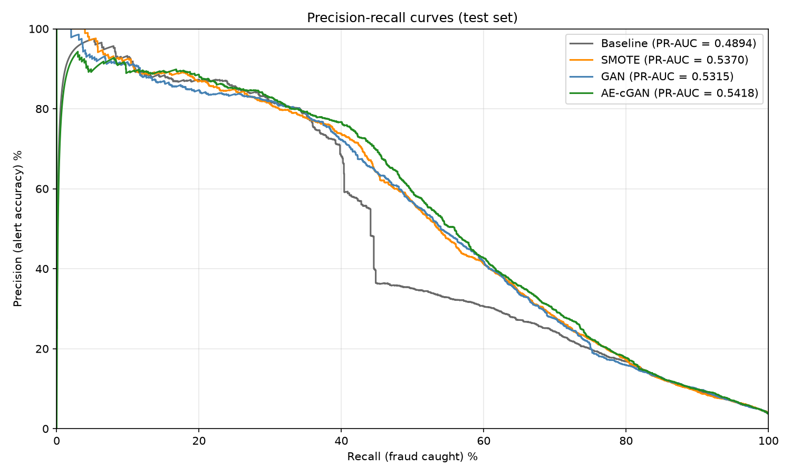
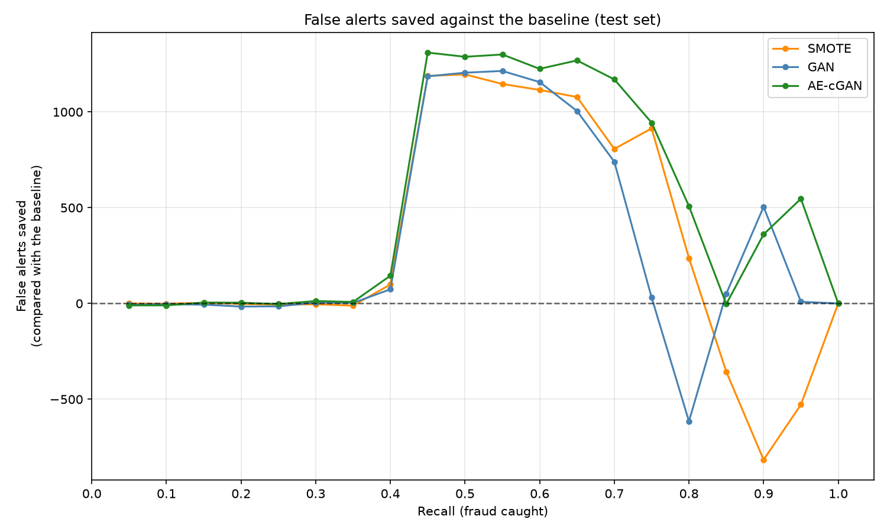

# Fraud detection with an autoencoder-guided conditional GAN


Credit-card fraud is rare (3.5% of the transactions in the IEEE-CIS dataset), so a classifier
sees few examples of what it has to find. This project tests whether **synthetic fraud generated
by a GAN, guided by an autoencoder's anomaly score**, helps a gradient-boosted classifier more
than no oversampling or than SMOTE.

## Results

Temporal split (70/20/10), seed 11, LightGBM with default settings throughout. Test scores come
from refitting on training + validation. Oversampling ratios are chosen on validation (SMOTE:
fraud / legitimate; GAN and cGAN: fraud count as a share of the original rows).

| Method | Ratio | Validation PR-AUC | **Test PR-AUC** | Test ROC-AUC | Test precision at 80% recall | Test precision at 90% recall |
|---|---|---|---|---|---|---|
| Baseline | - | 0.5076 | 0.4894 | 0.8966 | 0.168 | 0.096 |
| SMOTE | 0.05 | 0.5178 | 0.5370 | 0.9028 | 0.172 | 0.093 |
| GAN | 0.10 | 0.5187 | 0.5315 | 0.9023 | 0.159 | 0.099 |
| AE-cGAN | 0.10 | 0.5185 | **0.5418** | **0.9061** | **0.177** | 0.098 |





**What this shows.** All three oversampling methods improve test PR-AUC over the baseline
(0.489 to 0.532-0.542). AE-cGAN is nominally best on PR-AUC, ROC-AUC and precision at 80%
recall, but its margin over SMOTE (+0.005) and GAN (+0.010) is within the variation between
near-identical development configurations, and on validation the three are indistinguishable.
**With a single seed this repository does not claim a ranking among them.** See
[the methodology](docs/methodology.md#differences-from-the-thesis) for how these numbers differ
from the original thesis and why.

## How it works

1. **Prepare the data:** merge, split by time, clean and encode (statistics learned on train only).
2. **Autoencoder** trained on legitimate transactions only; its reconstruction error becomes an
   anomaly score for every transaction.
3. **GAN / conditional GAN** trained on the real fraud rows. The cGAN is conditioned on the
   anomaly score of the transaction it imitates.
4. **Oversample** the training fraud (SMOTE, GAN or cGAN), train LightGBM and compare on
   validation, then on test.

## Quick start

```bash
git clone https://github.com/pponci/fraud-detection-cgan.git && cd fraud-detection-cgan
uv sync
uv run nbstripout --install --attributes .gitattributes   # keeps notebook outputs out of git
make check                                                # lint, types, unit tests
```

Download the data as described in [`data/README.md`](data/README.md), then run the whole
pipeline (long; the generators train for 1000 epochs):

```bash
make reproduce
```

or step by step:

```bash
uv run python scripts/prepare_data.py --dataset ieee_cis
uv run python scripts/run_benchmark.py --config configs/experiments/development/benchmark/smote_sweep.yaml
uv run python scripts/train_autoencoder.py --config configs/experiments/development/ae/ae_08.yaml
uv run python scripts/train_gan.py --config configs/experiments/development/gan/gan_08.yaml
uv run python scripts/train_gan.py --config configs/experiments/development/cgan/cgan_04.yaml
uv run python scripts/evaluate.py
```

Results land in `results/ieee_cis/` (committed) and heavy files such as checkpoints in
`artifacts/` (ignored). Every earlier experiment is runnable the same way from its config; the
[experiments table](docs/experiments.md) lists them all with their results.

> **LightGBM:** `pyproject.toml` builds LightGBM from source with OpenMP disabled, so `uv sync`
> needs `cmake` and a C++ compiler.

## Repository layout

| Path | Purpose |
|---|---|
| `src/fraud_detection/` | the library: data, models, augmentation, training, evaluation |
| `configs/datasets/` | dataset definitions |
| `configs/experiments/development/` | one config per experiment that was run (autoencoder, GAN, cGAN, SMOTE) |
| `configs/experiments/final/` | the four methods of the final comparison |
| `scripts/` | command-line entry points |
| `results/` | committed tables, loss histories and figures, in `<dataset>/<experiment>/seed_<n>/` |
| `artifacts/` | ignored: checkpoints, anomaly scores, predictions |
| `data/` | ignored: see `data/README.md` |
| `tests/unit/` | unit tests (run in CI, no data needed) |
| `docs/` | methodology and the generated experiments table |
| `notebooks/` | exploratory analysis (outputs stripped on commit) |

## Documentation

- [Methodology](docs/methodology.md): data, models, protocol, metrics and every known caveat.
- [Experiments](docs/experiments.md): every iteration that was run, with its result.

## Limitations and next steps

Single seed, single dataset, and two differently defined oversampling ratios; details in the
methodology. The natural next steps are multiple seeds with confidence intervals and a second
dataset.

## License

[MIT](LICENSE)